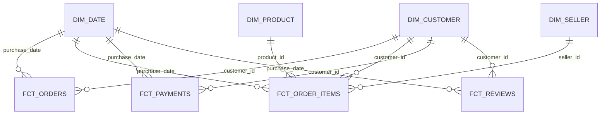

# Gold Dimensional Model and Lineage

## 1. Architecture and boundaries

The implementation is a **fact constellation** (shared dimensions and multiple facts), not a single flattened transaction table. Source CSVs were ingested to Bronze and transformed to Silver; the Gold layer consists of analytical Delta tables. The current facts are independent consumer models of Silver data; they are not written from other Gold facts.

**Diagram interpretation:** these are proposed logical filtering paths. They do not claim that Power BI relationships have been created or that Unity Catalog foreign-key constraints are enforced. `dim_date` has multiple potential roles; the diagram shows the purchase-date role only. On this historical dataset, both `dim_customer.customer_id` and `fct_orders.customer_id` are unique in the observed rows, although the intended model still treats the former as the dimension lookup.

## 2. Dimension contracts

| Table | Business key | Silver inputs | Core attributes / semantics |
|---|---|---|---|
| `dim_date` | `date_key` (`yyyyMMdd`, integer) | `sl_orders`, `sl_order_items`, `sl_reviews` (event date bounds) | `full_date`, year, quarter, month, ISO weekday/week, month boundaries, `is_weekend` |
| `dim_customer` | `customer_id` | `sl_customers` LEFT JOIN `sl_geolocation` on normalized ZIP prefix | Original ZIP/city/state; `customer_unique_id` for consumer identity; approximate geolocation and missingness flags |
| `dim_product` | `product_id` | `sl_products` LEFT JOIN `sl_product_category_translation` | Original product physical attributes, category, nullable translation, `product_category_status` |
| `dim_seller` | `seller_id` | `sl_sellers` LEFT JOIN `sl_geolocation` on normalized ZIP prefix | Original ZIP/city/state; approximate geolocation and missingness flags |

**Identity:** `customer_id` is associated with an order/customer record; `customer_unique_id` identifies the consumer across those records. `dim_customer` deliberately contains repeated `customer_unique_id` values. Do not deduplicate the dimension on that column.

**Category status:** `TRANSLATED` when a category translation exists; `UNTRANSLATED` when the source category exists but translation is missing; `MISSING_CATEGORY` when source category is NULL. A missing category is not a zero or fabricated category.

**Geolocation status:** `AVAILABLE` for a matched ZIP with coordinates, `MISSING` for a matched ZIP without coordinates, `NOT_FOUND` for no ZIP match. The coordinates are selected reference points for ZIP prefixes, not exact addresses; geography is incomplete and not externally postal-verified.

**Calendar:** 1,827 rows from 2016-01-01 through 2020-12-31. The 2020 endpoint arises from an observed maximum `sl_order_items.shipping_limit_date` of 2020-04-09; it does not imply transactions continued through 2020. Session timezone observed in validation was `Etc/UTC`; source timezone remains undocumented.

**History handling:** no Type 2 slowly changing dimensions or arbitrary surrogate keys were introduced for this static historical source. No historical change feed or attribute-effective intervals are available.

## 3. Fact contracts

| Table | Exact grain / key | Silver inputs | Measures and derivations |
|---|---|---|---|
| `fct_orders` | One `order_id` | `sl_orders` + per-`order_id` aggregates of `sl_order_items` and `sl_payments` | Counts, product/freight/paid values, reconciliation differences, purchase/estimated/actual delivery dates, delivery flags and durations |
| `fct_order_items` | One (`order_id`, `order_item_id`) | `sl_order_items` LEFT JOIN `sl_orders` | `item_value_brl`, `freight_value_brl`, `ordered_total_value_brl` at item grain; keys for product, seller, customer and purchase date |
| `fct_payments` | One (`order_id`, `payment_sequential`) | `sl_payments` LEFT JOIN `sl_orders` | `payment_type`, `payment_installments`, `payment_value_brl`, zero-amount and zero-installment flags |
| `fct_reviews` | One (`review_id`, `order_id`) | `sl_reviews` LEFT JOIN `sl_orders` | Raw score, title and message, review creation/answer times, non-null text flags |

### 3.1 Order accumulation and independent aggregation

`fct_orders` is a historical accumulating snapshot of the order lifecycle. Item aggregates and payment aggregates are computed separately by `order_id` before both are LEFT JOINed to the one-row-per-order `sl_orders` source. Otherwise a two-item, three-payment, two-review order could expand to 12 joined rows, multiplying amounts.

`fct_orders.ordered_total_value_brl = SUM(sl_order_items.price + sl_order_items.freight_value)` per order **when items exist**. Its `paid_value_brl` is the corresponding sum of payments **when payments exist**; neither amount is a recognized accounting revenue measure. `has_order_items` and `has_payments` distinguish missing related rows from a valid recorded zero.

### 3.2 Time and delivery contracts

- The **purchase date** is a business analysis axis; other dates are separate roles.
- `shipping_limit_date` is an item shipping deadline, **not** a customer-promised delivery date.
- The historical late delivery flag is defined only for `order_status = 'delivered'` with actual and estimated delivery timestamps present.
- `is_late_delivery = CAST(order_delivered_customer_date AS DATE) > CAST(order_estimated_delivery_date AS DATE)` for eligible orders. A delivery on the promised calendar day is on time.
- `days_late` is zero for eligible on-time orders and a positive whole-day difference for eligible late orders; ineligible outcomes are NULL.
- No source-timezone offset is inferred from Spark display formatting.

### 3.3 Review grain and text preservation

`review_id` **alone is not unique**; the validated composite key is (`review_id`, `order_id`). Multiple reviews for one order are retained. The source score, title and message are not normalized, stripped, or collapsed. Presence flags mean `IS NOT NULL`, not “text is non-empty and usable.” Review content and post-delivery timestamps are not features available at order creation time.

## 4. Logical relationship rules

| Dimension-to-fact | Joining columns | Analysis use |
|---|---|---|
| `dim_customer` → each fact | `customer_id` | Customer location and identity; consumer counting needs `COUNT(DISTINCT customer_unique_id)` |
| `dim_product` → `fct_order_items` | `product_id` | Item/product/category analysis |
| `dim_seller` → `fct_order_items` | `seller_id` | Seller-level item values and order participation |
| `dim_date` → `fct_orders` | `date_key` to selected purchase/estimated/actual delivery date key | Explicit role per measure |
| `dim_date` → `fct_order_items` | `date_key` to purchase or item shipping-limit date key | Purchase trends vs item shipping deadlines |
| `dim_date` → `fct_payments` | `date_key` to order purchase date key | Only purchase-cohort context; **not** actual payment date |
| `dim_date` → `fct_reviews` | `date_key` to purchase/review creation/review answer date key | Distinguish order cohort, review creation and answer timing |

**Do not create direct, bidirectional fact-to-fact relationships by default.** A seller/category selection should not automatically filter order-level delivery KPIs, because `fct_orders` has no `seller_id` or `product_id`. For seller-scoped order metrics, use a separate explicitly designed query/measure with carefully deduplicated order IDs; do not multiply order-level amounts through item rows.

## 5. Current implementation versus future consumption

Confirmed: all eight Delta tables built; 82 checks passed across the documented contracts; business analysis notebook executed with results reported by the owner.

Not confirmed: a deployed Power BI semantic model, full orchestration, transactional publication of all eight tables together, incremental processing, or live operational monitoring. See `validation_operations.md` and `power_bi_model_guidance.md` before creating external consumers.
